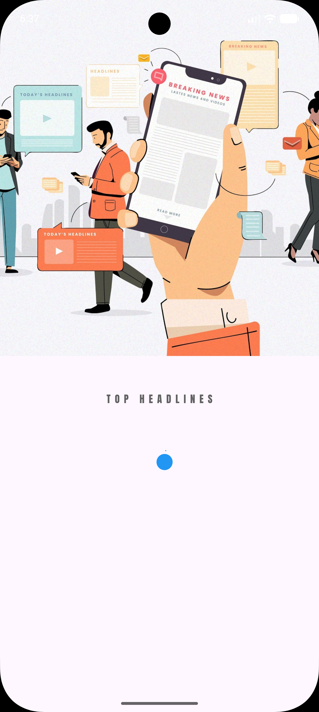
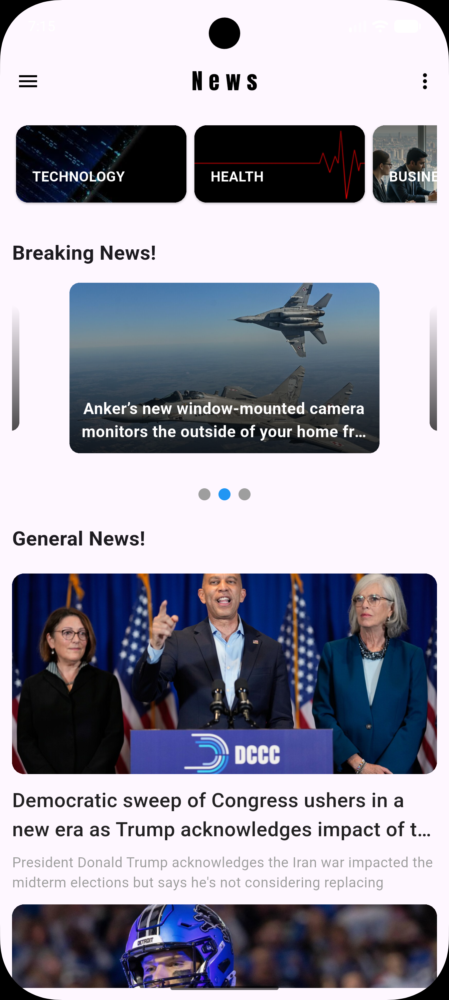
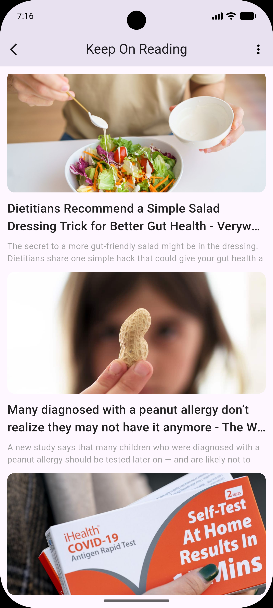
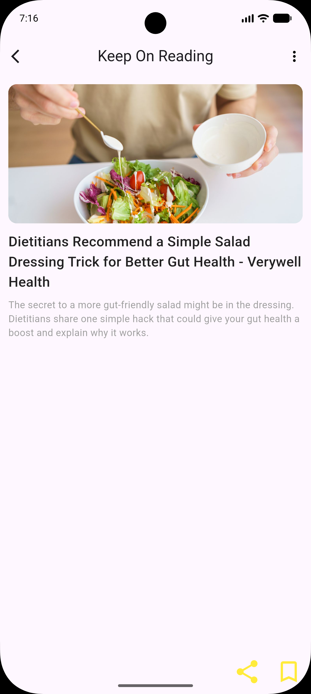

# 📰 NewApp - Flutter News Application

<div align="center">


**A modern, News Application built with Flutter.**

</div>

---

## 📱 About The Project

**NewApp** is a comprehensive mobile application that delivers real-time news directly to the user. The app focuses on providing a seamless reading experience with a logical user flow. It fetches data from a REST API, organizes it by categories, and highlights urgent news through an interactive slider.

---

## 📸 Screenshots

<div align="center">

| Splash Screen | Home (General News) | 
| :---: | :---: | :---: |
|  |  | 

| Category Filter | News Details | Read Article |
| :---: | :---: | :---: |
|  |  |  |

</div>

---

## ✨ Features

- 🚀 **Splash Screen:** A smooth initialization screen that loads essential data.
- 🗞️ **General News:** Displays a clean list of top headlines.
- ⚡ **Breaking News Slider:** A dedicated carousel for urgent and trending news.
- 🗂️ **News Categories:** A horizontal scrollable bar (e.g., Sports, Tech, Health) to filter the feed.
- 📄 **Article Details:** Full-page view for reading the news with high-quality images and text.

---

## 🔄 App Flow

1. **Splash Screen** ➡️ Initializes app and fetches initial data.
2. **Home Screen** ➡️ Shows general news, Breaking News Slider, and Categories.
3. **Category Screen** ➡️ Fetches and displays news based on the selected category.
4. **Details Screen** ➡️ Displays the full article when a news card is tapped.

---

## 🛠️ Tech Stack

| Technology | Purpose |
|------------|---------|
| **Flutter** | UI Framework |
| **Dart** | Programming Language |
| **REST API** | Fetching real-time news data |
| **http** | HTTP client for network requests |

---

## 🚀 How to Run

1. **Clone the repository:**
   ```bash
   git clone https://github.com/maramrmilad7/News-Application.git
